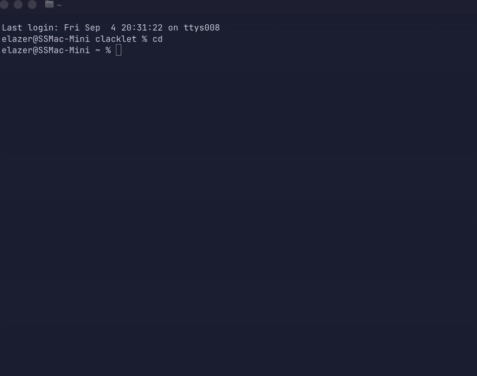

<p align="center">
  <a href="https://danmu.elazer.wang/">
    
  </a>
</p>

<h1 align="center">DANMU</h1>

<p align="center">
  <strong>面向知识型主播的免费开源弹幕与提问工作台。</strong><br>
  在终端里看互动、找问题、审核助手回复，保留每场记录。
</p>

<p align="center">
  <a href="https://danmu.elazer.wang/">官方网站</a> ·
  <a href="https://danmu.elazer.wang/guide/"><strong>使用手册</strong></a> ·
  <a href="https://github.com/rockythink/shisui-danmu/releases/latest">下载最新版</a>
</p>

<p align="center">
  <a href="https://github.com/rockythink/shisui-danmu/actions/workflows/ci.yml"></a>
  <a href="https://github.com/rockythink/shisui-danmu/releases/latest"></a>
  <a href="https://github.com/rockythink/shisui-danmu/blob/main/LICENSE"></a>
</p>

<p align="center">macOS · Linux · Windows | Bilibili | Ratatui | MPL-2.0</p>

DANMU 把 B 站历史弹幕、实时互动、重点问题、发送状态和有限 OBS 控制放在同一个终端里。它不是播放器，也不是完整直播画布或另一套 OBS。

<p align="center">
  <a href="https://danmu.elazer.wang/danmu-product-demo.mp4">
    
  </a>
</p>

这是基础功能实录，**不代表已经展示 v0.5.0 的 AI 助手流程**。点击画面观看完整 MP4。

## 未发布：轻量 HTTP 助手与设置精简

以下说明当前源码的未发布行为，不属于已发布的 v0.5.0 / v0.5.1，也不承诺下一版版本号。下文历史发布说明保留当时事实，不能当作当前内置助手的安装指南。

- **四类设置**：`/settings` 保留 B站账号与直播间、OBS、AI助手、系统与关于。外观不再占设置类别；用 Tab 切换布局，或用 `/display theme`、`/display names`、`/display time`、`/display layout` 调整。历史空闲返回秒数仍可通过 TOML 的 `history_idle_seconds` 配置。
- **AI 路径收拢**：AI助手下分模型、发送策略、人设与资料、维护。`/ai replies` 只保留方案、联网搜索、屏蔽词；`/ai materials` 保留名字与人设；`/ai advanced` 保留处理可见弹幕、结束。本场 `/ai range`、`/ai topic` 不变；`/ai workspace`、`/ai reset` 与重建模型上下文入口已移除。
- **方案一次保存**：少主动回复、侧重回答问题、感谢礼物、关注和分享，分别保存一组十项偏好，不改账号、模型或自动发送许可，也不启动助手。感谢默认关闭；感谢方案包括礼物与上舰、关注、分享，不含点赞。选方案会关闭联网搜索，需要时再显式开启。
- **固定安全策略与资料引用**：开麦让位和有限内容修复固定开启；让位不等于停止回答文字问题，修复不处理未知送达，也不重发。已有公开简介与 `PROJECT.md` 默认引用，仍受原有资料与权限边界约束；资料文本合计 8KiB 上限不变，技能仍须显式选中文件，未选技能不加载、不执行。
- **内置链路切换**：直接使用 OpenAI 兼容 Chat Completions、Anthropic Messages 或 ChatGPT 订阅官方 preview；不再启动 ACP / coding CLI，不需要安装 Pi、Node 或适配器，`danmu setup pi` 已退役。外部 Agent 的 CLI/MCP 与配置生成器仍保留。
- **配置迁移**：`assistant.json` 改为 format=4，`api` 替代旧宿主、程序路径、原生来源及参数。无版本/format2/3 只在内存严格迁移，加载不写盘；首次显式保存先逐字备份到 `assistant.pre-api.json`，备份冲突或失败不覆盖设置。业务资料与归档保留，但旧自动发送、启动续用、联网搜索均关闭，必须重新配置、启动并授权。原生规则不扫描、不复制，必要文本由本人放入既有 SYSTEM、人设、PROJECT 或 `preferences`。
- **文件级项**：`workspace`、`skills`、`preferences` 与 `api.max_output_tokens`、`api.openai_token_limit` 从同目录配置启动读取，外部修改后重启。旧资料引用、开麦让位、有限修复 false 仍只在内存归一化为开启；不因加载覆盖原文件，自有工作区准备权限不变。

## v0.5.1 修复

- 修复 Windows 启动时的 `Initial console modes not set`，并避开 Windows 后端不支持的键盘增强命令。
- 修正退出时鼠标捕获与输入模式的恢复顺序，保持原终端可正常继续输入。
- 无需删除历史库、重配账号或停止 OBS。详细说明见[更新日志](https://danmu.elazer.wang/changelog/#v051)。

## v0.5.0 变化

- **本机 ACP 助手**：接入用户自己的原生 AI 工具，打开面板、连接模型、启动值班与允许公开发送分别控制。Pi 提供显式准备命令 `danmu setup pi`，不代装原生 Pi、不登录、不启动推理。
- **工作区与历史**：可编辑人设资料、按房间历史索引、跨场检索和维护副本；旧消息标记为 `↶`，不会重新进入 AI 队列。后台加载不阻塞主界面，修复先备份，不删除原始 Journal。
- **统一设置与账号**：`/settings` 汇集五类设置；主账号与独立助手号分开管理、分开发送队列，独立号失效不回退主号。审核与编辑保留人工草稿。
- **候选安全与发送诊断**：未知或重复本批目标整批拒绝，随后继续处理新消息；真实连接、协议、身份和磁盘错误仍明确暴露。发送未确认不自动补发。
- **低成本合批与轮次诊断**：普通空白、纯笑声和平台已识别纯表情可跳过；连续空轮后普通消息按 5–10 秒合批，点名不等合批但仍受单飞与授权限制。`/diag` 区分零候选、原生无正文、待审、拒绝和真正错误。
- **官网使用手册**：用 Astro Starlight 承载完整操作文档，提供章节导航与搜索；README 保持为产品入口。

从 0.4.5 或 0.5.0 升级请沿用原安装渠道，运行 `danmu --version` 确认 `0.5.1`，再自行重启所有旧 TUI 实例。无需删除历史库。历史版本说明见 [Releases](https://github.com/rockythink/shisui-danmu/releases)。

## 安装与首次启动

任选一种渠道，安装后的命令都叫 `danmu`：

| 渠道 | 安装命令 | 适用环境 |
| --- | --- | --- |
| npm | `npm install -g danmu-tui` | Node.js 18+ |
| Bun | `bun install -g danmu-tui` | Bun |
| Homebrew | `brew install rockythink/tap/danmu` | macOS、Linux |
| Cargo | `cargo install shisui-danmu --locked` | Rust 1.89+ |
| 安装脚本 | 见下方 | macOS、Linux、Windows Git Bash |
| 预编译包 | [GitHub Releases](https://github.com/rockythink/shisui-danmu/releases/latest) | 下列五种平台构建 |

```bash
curl -fsSL https://raw.githubusercontent.com/rockythink/shisui-danmu/main/script/install_release.sh | bash
```

脚本按平台下载 Release、校验 SHA-256，默认安装到 `~/.local/bin/danmu`。npm/Bun 包同样运行 Rust 原生程序，不是 JavaScript 重写，也不通过 `postinstall` 下载二进制。

| 平台 | Release 文件 |
| --- | --- |
| macOS Apple Silicon | `shisui-danmu-macos-aarch64.tar.gz` |
| macOS Intel | `shisui-danmu-macos-x86_64.tar.gz` |
| Linux x86_64 | `shisui-danmu-linux-x86_64.tar.gz` |
| Linux aarch64 | `shisui-danmu-linux-aarch64.tar.gz` |
| Windows x86_64 | `shisui-danmu-windows-x86_64.zip` |

每个压缩包都有同名 `.sha256`。以上是**已发布基础 TUI** 的构建范围；v0.5.1 的旧内置 ACP 有 Unix/宿主限制。当前未发布 HTTP 链路不依赖该进程机制，但不据此声称 Windows/Linux 新模型页、浏览器授权或真实服务已经验收。

```bash
danmu --version
danmu <房间号>
```

公开监看无需登录。需要人工发送时，登录的是 DANMU，而不是浏览器：

```bash
danmu --login
danmu <房间号>
```

用哔哩哔哩客户端扫码；进入后在输入框写正文，按 Enter 发送，粘贴只插入内容。`danmu --logout` 只退出 DANMU 主账号。发送区的 `?` 表示送达未确认，不应当作确定失败自动重发。

升级、PATH、启动自检及各渠道细节见 [安装与升级](https://danmu.elazer.wang/guide/#安装与升级)。

## 高频操作

| 操作 | 入口 |
| --- | --- |
| 搜索指令，返回时保留草稿与光标 | Ctrl+O 或 `/commands` |
| 设置与操作总菜单 | `/settings` |
| 切换消息布局 | Tab |
| 浏览历史 / 选择回复对象 | ↑↓ / Shift+↑↓ |
| 插入选中对象的 @ | 选择后 Enter |
| 取消当前操作 / 返回实时 | Esc；浏览或选择状态下 End 也返回实时 |
| 助手运行面板 / 候选审核 | Ctrl+G 或 `/ai` / `/review` |
| 暂停助手与撤销发送许可 | Ctrl+P 或 `/pause` |
| 重点消息 / 搜索归档 | `/pin` / `/find [关键词]` |
| 诊断与上轮摘要 | `/diag`，F1 或 `?` 展开详情 |
| 安全退出 | Ctrl+C 或 `/quit` |

正常编辑输入时 End 是行尾。主界面可原生拖选文字，用终端复制快捷键复制；macOS 的 ⌘C 是复制，Ctrl+C 是退出。

OBS 从 `danmu --configure-obs` 或 `/settings obs` 配置。`/obs start` 会真的开始推流；`/obs stop` 需要确认，随后 3 秒内可按 Esc 取消。退出 DANMU 不会停止 OBS 推流。

## AI 与平台边界

本节面向**当前未发布源码**；最新正式 v0.5.1 仍是上面的历史实现。**程序开源免费，不等于模型或搜索免费。**

1. `/settings` → AI助手 → 模型（或 `/ai model`）选择连接方式。API Key 连接明确填写包含版本路径的基址、模型名，再用“设置/更换 Key”或 `/ai key` 打开隐藏输入；命令不接受明文参数。Enter 只保存，Esc 恢复原人工草稿，旧 Key 不回填界面。清除 Key 另需选择“清除”。
2. ChatGPT 订阅连接用“Continue with ChatGPT”由本人在系统浏览器授权；完成后自动读取账号目录并打开模型选择，首次只需明确选择一次模型。同注册重登录保留仍可用的模型，选已保存账号也自动读取目录；“读取账号模型”保留作刷新或失败后重读。不会自动选新模型、启动助手或授发送权。采用官方 OSS/local Sign in with ChatGPT，不复用 Codex/Pi/ACP OAuth，不需要安装 coding CLI，不读取 ChatGPT 旧聊天历史。官方 preview 当前面向符合资格的 Plus/Pro 用户；资格及模型以官方授权/目录为准。额度与 ChatGPT 共享并受每应用限制，见 [Usage](https://chatgpt.com/settings/usage)；不承诺永久支持或无限额度。
3. 保存普通配置不推理、不授权；登录完成或选择账号会自动联网读取目录，手动刷新也会联网。`/ai start` 只准备本机 worker，等待新消息不产生模型请求，“就绪”不代表远端鉴权已验证。先用 `/review` 阅读候选，完整看过后 Shift+Enter 批准；编辑中的 Enter 只保存、不发送。
4. 更换连接、Key、订阅账号或联网设置前先 `/pause`，等待在途请求与账号操作结束并撤销发送权/待续用。自动发送仍需本人明确授权；同房间、同发送 UID 且恢复检查通过才可续用，旧后端迁移不继承授权。批量批准当前候选不授权未来候选。

API Key 只有一个当前记录，位于 `assistant.json` 同目录 `assistant-secrets/api-key.json`，按协议与规范化基址匹配，同服务换模型可复用，换服务不发送旧 Key。订阅 Token 独立保存到 `assistant-secrets/chatgpt.json`，可保留多个隔离注册；订阅只访问官方 API 地址。两者都是本机权限保护的**明文**，不是钥匙串或加密保险箱：Unix 私有根 0700、文件 0600，拒绝不安全路径，不自动改宽权限；Windows 不承诺等价 ACL。不要同步、提交或交给外部 Agent。手工修改 Key 文件不会改变运行中的快照，须暂停后重新启动；取消本机 future 不代表远端推理或收费已停止。退出订阅区分本地 Token 已清除和远端撤销是否确认，亦可在 ChatGPT 设置管理授权。

联网默认关闭。开启后最多一次 Exa 搜索、三条来源：程序只发送冻结的本批完整公开 Danmu/SC 正文（非空、无控制字符、最多240个 Unicode 字符），不让模型自由写 query，不携带 UID、昵称、私有资料或历史扩写。搜索失败/限流/无结果为不可用，只补全一次且候选强制待审，不重试或切付费搜索。公共入口可用性/永久免费未承诺。

每轮从本地组装完整选定资料、本场上下文、相关观众/场次历史及实际送达结果，不依赖供应商会话。Journal/SQLite 与工作区保留；历史索引导入场次与观众事件，**不承诺所有旧助手回复已进入历史检索**，原回复仍在 Journal。仅存在于原生宿主、未归档的聊天不自动迁移。

内容错误整批拒绝、不重试，保留原候选及有效许可并继续新消息；HTTP/外层协议/连接/凭据或额度等真实故障暂停并撤权，处理后显式启动。额度错误提供安全摘要与 Usage 指引，保留订阅 Token，**不自动转为 API 付费、不换模型、不重试旧批**。平台目前只接 B 站；模型不能授权发送、操作电脑或自报送达。麦克风状态不是语音识别，合批不保证固定省费比例或模型永不误判。真实模型、官方账号/额度与真实联网效果未由这些源码说明验收。

订阅推理逐事件解析SSE：单事件（含字段、注释与换行）≤256KiB，整个解压流≤8MiB、最多4096个数据事件；只在完整终态及HTTP正常结束后准入，中间推理文本不进入候选。两种非流式API和HTTP错误仍限256KiB。底部普通提示3秒、警告/错误15秒后消退，操作进度保留到完成；清除文字不会恢复已暂停助手或发送权，错误仍可从`/diag`及归档查看。

## 文档

- **[官网使用手册](https://danmu.elazer.wang/guide/)**：安装、设置、OBS、AI、审核、账号、成本、数据与排错。
- [故障排查](https://danmu.elazer.wang/guide/#故障排查)：先看诊断、保留草稿和原始历史，不靠删库或重放旧消息解决问题。
- [命令参考](https://danmu.elazer.wang/guide/#命令参考与进一步阅读)：完整 CLI、TUI 与高级隔离入口。
- [开发接入向导](https://github.com/rockythink/shisui-danmu/blob/main/docs/agent-onboarding.md)、[功能矩阵](https://github.com/rockythink/shisui-danmu/blob/main/docs/terminal-feature-matrix.md)：实现契约与验证边界，不代替用户手册。

用户手册只维护在官网的 Starlight 内容目录，随源码版本管理，不另维护一份 GitHub 操作手册。

## 高级集成

<details>
<summary>外部 Agent、CLI/MCP 契约与隔离运行</summary>

### 连接已有实例

外部 Agent 与 TUI 连接同一运行实例，不另启动 TUI、不读取平台凭据。用户须显式提供绝对私有目录：

```bash
danmu --instance /绝对私有实例目录 <房间号>
```

另一个终端或宿主连接该实例：

```bash
danmu --instance /绝对私有实例目录 agent status '{}'
danmu --instance /绝对私有实例目录 mcp
```

MCP 入口由宿主以 stdio 启动，stdout 只输出 JSON-RPC。没有 `--instance` 时基础 TUI 仍可使用，但不向外部 Agent 开放端点。

### 共用业务契约

CLI：`danmu --instance DIR agent 操作 'JSON对象'`。MCP 工具名为 `danmu_操作`，宿主可能增加服务器名前缀。

| 操作 | 参数与结果 |
| --- | --- |
| `status` | 返回本场 `session`、`active`、`available`、`sending_enabled`、最新 `cursor`；不授权 |
| `messages` | `session`、`cursor`、`limit`（1..200，默认 50）、`wait_ms`（0..25000）；返回到达顺序的稳定消息 ID、消费 `cursor`、`latest_cursor`、`oldest_cursor` 及 `gap`。空页是正常超时，不自动标黄 |
| `report` | `session`、`caller`、`request_id`、`message_id`、`state`（`processing` / `finished` / `failed`）；不能自报 confirmed |
| `reply` | `session`、`caller`、`request_id`、原 `message_id`、`text`、`candidate`；`candidate=true` 等待 TUI 确认；受理不代表发送 |
| `result` | `session`、`caller`、`request_id`；查询 `awaiting_approval` / `accepted` / `sending` / `confirmed` / `uncertain` / `rejected` / `cancelled` |

完整流程见[共享 danmu-duty Skill](https://github.com/rockythink/shisui-danmu/blob/main/agent-package/skills/danmu-duty/SKILL.md)。每场保留 512 项增量事件、4096 项幂等操作；超出窗口明确 `gap`，幂等记录满则拒绝新请求而非驱逐旧记录。同一操作重传必须保持 `caller`、`request_id` 与参数不变；不同调用者可合法回复同一原消息。

每次启动或新场都有独立随机 `session`；旧请求不跨场补发，预载历史不充当增量游标。外部工具不能开自动许可；生产启动恢复只采用本人先前保存、范围仍匹配且核验通过的授权，工具重连本身不恢复权限。

Unix 实例目录 0700、描述文件 0600；端点只绑定 127.0.0.1 随机端口，使用实例私有随机 token 与独占目录锁。同一系统用户不是抵御恶意本机代码的 OS 沙箱，不向不可信进程共享实例目录。

### MCP 取消语义

每连接最多 16 个未回收工具调用，完成后回收容量。`notifications/cancelled` 按当前连接的 JSON-RPC `requestId` 取消尚未完成的 `danmu_messages` 有限等待，释放读取连接，不再发送该取消请求的响应。未知或已完成 ID 忽略；完成早于取消时，允许已经发出的一次响应。

取消通知不撤销已提交回复，不开关发送许可。按 [MCP 取消规范](https://modelcontextprotocol.io/specification/2025-11-25/basic/utilities/cancellation)，客户端应停止等待被取消 ID，而不是继续等待正常空页。发送结果不确定时查询原请求，不使用新 ID 猜测重发。

Runner 持有时 `status.driver=runner`。外部读/查保留，同一内置调用者 `danmu-assistant` 的 `report/reply` 返回 `runner_active`；其他独立调用者仍受原权限控制。不要换调用者绕过同一助手互斥；切换前由用户停止旧外部值班，DANMU 不抢停外部 Agent。

### 外部配置生成器

```text
python3 script/agent_config.py --host HOST --binary /绝对路径/danmu --instance /绝对私有实例目录
```

生成器只打印配置，不安装、不写宿主设置、不启动宿主。`HOST` 可选 `omp`、`claude`、`codex`、`opencode`、`gemini`、`cursor`、`vscode`、`amp`、`pi`；这是**外部 coding Agent** 的接入格式列表，不是当前内置 Runner 的后端列表。Amp 使用 `amp.mcpServers`；Pi 只输出明确标记的 CLI 示例，不安装 MCP 扩展。用户负责合并配置、信任服务器与限制宿主自身的其他能力。

### 无房间隔离示例

```bash
INSTANCE="$(mktemp -d /tmp/danmu-agent.XXXXXX)"
danmu --instance "$INSTANCE" local --assistant
```

`local` 要求全新的空私有目录，只使用人工输入与 LocalTransport，不读取生产配置、不登录、不连接真实房间或 OBS。`--assistant` 只打开面板，不启动模型或授权。

在这个隔离 TUI 内可输入 `/event 观众甲 怎样理解增量游标？`，用 `/local confirmed|uncertain|rejected` 选择本地传输结果，用 `/session end|new` 演练场次切换。这些是本地 TUI 命令，不是外部 CLI/MCP 控制口；外部五操作不能启动 Runner、注入事件或批准发送。

工具/本地入口不能混用房间、登录、OBS、回放或生产配置参数。当前内置助手没有 `setup` 子命令。退出只移除该实例端点并释放锁，保留记录；本地自动许可不保存为真实房间授权。

</details>

## 开发、贡献与许可

需要 Rust 1.89+；网站构建使用 Node.js 24。

```bash
git clone https://github.com/rockythink/shisui-danmu.git danmu
cd danmu
./script/verify.sh
./script/install_cli.sh
```

本地源码目录可命名为 `danmu`，不要求与远程仓库同名。目录改名不改变 Cargo 包名 `shisui-danmu`、命令 `danmu`、用户配置或历史数据目录；已有终端、编辑器及外部脚本中的绝对源码路径需同步更新。

`verify.sh` 执行格式检查、严格 Clippy、全目标测试、Release 构建及 CLI 冒烟。CI 在 macOS、Linux、Windows 执行 Rust 门禁，并构建官网。平台协议留在 Adapter，领域模块不直接依赖 B 站协议字段。贡献前阅读 [CONTRIBUTING.md](https://github.com/rockythink/shisui-danmu/blob/main/CONTRIBUTING.md)。

源代码采用 [MPL-2.0](https://github.com/rockythink/shisui-danmu/blob/main/LICENSE)，第三方说明见 [THIRD_PARTY_NOTICES.md](https://github.com/rockythink/shisui-danmu/blob/main/THIRD_PARTY_NOTICES.md)。开源许可不授予 DANMU 名称、Logo 或其他品牌资产的商标许可，详见 [TRADEMARKS.md](https://github.com/rockythink/shisui-danmu/blob/main/TRADEMARKS.md)。

安全问题按 [SECURITY.md](https://github.com/rockythink/shisui-danmu/blob/main/SECURITY.md) 私下报告。不要在公开 Issue 中提交 Cookie、CSRF token、OBS 密码、模型认证、Bridge token 或含个人信息的历史记录。
